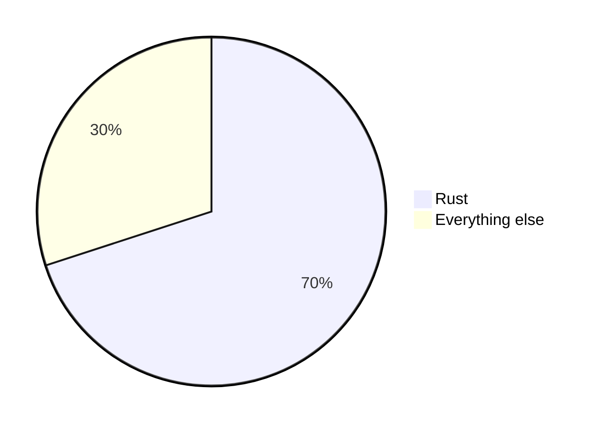

# mdcast

Markdown → **DOCX · ODT · PDF · PDF-presentation · PPTX · reveal.js HTML**, in
one async Rust library and a thin CLI on top of it.

The pitch:

- **One markdown source, six outputs.** Write once, render to whatever the
  audience reads.
- **Per-page layout system.** Tag a page `hero`, `image-full`, `callout`,
  `thanks` — and have it honoured across every output format.
- **Pluggable everything.** Templates, images, reveal.js distribution — all
  fetched through one async `AssetProvider` trait. Your app feeds bytes from
  a DB, S3, an in-memory map, whatever.
- **Single self-contained HTML.** Reveal.js dist is bundled; with
  `--embed-resources` (default) the deck is one file with zero external URLs.

mdcast does **not** try to replace pandoc. Pandoc handles DOCX/PPTX/revealjs
because no Rust crate matches its OOXML fidelity. Typst handles PDF because
the LaTeX toolchain is slow and heavy. The value mdcast adds is the
**branding-and-layout layer** that sits on top of both.

## Quick start

PDF targets need nothing extra — the Typst compiler is embedded in the
library by default (a `typst` binary is an opt-in alternative for the CLI,
and `mdcast-server`'s default — see "Selecting the Typst compiler" below). Only the pandoc-backed targets
(docx/odt/pptx/html-reveal) need the `pandoc` binary:

```sh
yay -S pandoc        # arch
brew install pandoc  # macos
apt install pandoc   # debian/ubuntu
```

Build and render:

```sh
cargo build --release
./target/release/mdcast render slides.md \
    --target html-reveal \
    --out slides.html \
    --assets ./my-images/
```

You'll get a single self-contained `slides.html` you can open in any browser.

## A minimal markdown example

```markdown
<page class="hero">
# Q3 Operations Review

*F13 — for board discussion*
</page>

---

# Agenda

- Headlines
- Margins
- Open questions

---

# {.image-full}


---

> A simple plan, decisively executed, beats a perfect plan that ships late.

---

Closing remarks and next steps.
```

What you get with no extra config:

| Page | Class           | Why                                                     |
|------|-----------------|---------------------------------------------------------|
| 1    | `hero`          | Explicit `<page class="hero">` wrapper                  |
| 2    | `content`       | Default (no rule matched)                               |
| 3    | `image-full`    | Page body is just one image → shape rule                |
| 4    | `callout`       | Body is just a blockquote → shape rule                  |
| 5    | `thanks`        | Last page, no explicit class → positional rule          |

Run `mdcast explain slides.md` to print this table for any file.

## Frontmatter

A leading YAML block is stripped before the page splitter runs, so it never
becomes a phantom `hero` page:

```markdown
---
title: Q3 Operations Review
author: F13
date: 2026-07-03
---

# Real first page
```

Only a flat `key: value` subset is parsed — `title`/`author`/`date` populate
`DocMeta`, any other keys land in `DocMeta::extra`. Pandoc targets pass
`title`/`author`/`date` through as `--metadata` (revealjs `<title>`,
docx/pptx document properties). No frontmatter block → `DocMeta` stays
default, same as before.

## Page boundaries and classes

Two surface syntaxes, both accepted:

- HTML-style: `<page class="hero">…</page>`
- Pandoc fenced div: `::: {.hero}` … `:::`

Outside an explicit wrapper, **`---` thematic breaks split pages.** The
auto-classifier then fills in a class:

1. **Explicit class** (from a wrapper) — always wins.
2. **Content shape** — `single_h1_only` → `section-divider`,
   `single_image_only` → `image-full`, `single_blockquote_only` → `callout`.
3. **Positional** — first page → `hero`, last page → `thanks`.
4. **Default** — `content`.

All rules live in `brand.toml`:

```toml
[auto_layout]
first   = "hero"
last    = "thanks"
default = "content"

[[auto_layout.rules]]
when  = "single_h1_only"
class = "section-divider"

[[auto_layout.rules]]
when  = "single_image_only"
class = "image-full"
```

## Built-in classes

| Class             | Where it shows up                                    |
|-------------------|------------------------------------------------------|
| `hero`            | Title / cover                                        |
| `content`         | Body pages — paragraphs, lists, the usual            |
| `thanks`          | Closing                                              |
| `image-full`      | Full-bleed image                                     |
| `section-divider` | Single-heading section break                         |
| `callout`         | Pull-quote / emphasised single block                 |

A class name resolves to a *different template per target*. The same
`<page class="hero">` produces:

- a centred large-type cover **in PDF** (via `typst/layouts/pdf/hero.typ`)
- a dark-background title slide **in PDF-presentation** (via
  `typst/layouts/pdf-presentation/hero.typ`)
- a `<section class="hero">` **in reveal.js** (styled by the theme CSS)
- a `Hero` paragraph-style **in DOCX/ODT** (from the reference doc)

Missing template for some class? The renderer logs a warning and falls back
to `content`. Authors are never blocked.

## Branding reveal.js decks (issue #57)

`html-reveal` projects `BrandSpec` (the same `brand.toml` that drives
page-classification rules) into a generated CSS layer plus an optional logo
overlay — no new pandoc invocation, no template changes. A document with no
`--brand` (or a `brand.toml` with no `palette`/`fonts`/`logo`) renders
byte-identical to before this existed.

**Palette/font mapping.** Recognised `[palette]`/`[fonts]` keys map onto
reveal.js 4.x's own theme CSS custom properties, scoped to `.reveal`:

| `brand.toml` key      | reveal.js custom property         |
|------------------------|-----------------------------------|
| `palette.background`   | `--r-background-color`            |
| `palette.heading` (falls back to `palette.primary`) | `--r-heading-color` |
| `palette.text`         | `--r-main-color`                  |
| `palette.link`         | `--r-link-color` / `--r-link-color-hover` |
| `palette.accent`       | `--r-selection-background-color`  |
| `fonts.body`            | `--r-main-font`                   |
| `fonts.heading`         | `--r-heading-font`                |
| `fonts.code`            | `--r-code-font`                   |

Every `[palette]` key is *also* emitted as `--brand-<key>`, so per-class CSS
can reach a color the table above doesn't know about (see below).

**Logo overlay.** An optional `[logo]` table in `brand.toml`:

```toml
[logo]
key = "img/logo.svg"     # an AssetProvider key — same namespace image refs use
position = "top-right"   # top-right (default) | top-left | bottom-right | bottom-left
width = "120px"          # optional
```

The backend fetches `key` through the `AssetProvider`, embeds it as a data
URI, and overlays it on every slide via `position: fixed`. A key missing from
the provider logs a `tracing::warn!` and the render proceeds without a logo —
never a hard failure.

**Per-class CSS escape hatch.** Slides already carry `{.<class>}` from the
page's class (`<section class="hero">` etc.), so hand-written CSS can target
it directly:

```css
.reveal section.hero { text-align: left; }
.reveal section.callout { background: var(--brand-accent); }
```

Provide such CSS by giving the `AssetProvider` a `revealjs/brand.css` key —
its contents are appended to the generated `<style data-brand>` block. This
is the only per-class hook for reveal.js; there is no per-class template like
typst's layouts.

Because pandoc's `--embed-resources` inlines whatever a stylesheet's
`url(...)`/`@import` names — host files included — that block is scrubbed
first (see "What pandoc may read" below): only `data:` URLs survive (plus
`http(s):` in a `remote-images` build); any other `url(...)` becomes `none`
and any other `@import "…"` is dropped, each with a warning. `</` and `&` are
escaped (`<\/`, `\26 `) so the block can neither close its `<style>` early
nor smuggle a path past the scrub as an HTML character reference — which
means a CSS-nesting `&` selector does not work here. The same scrub applies
to every `.css` file under `revealjs/` (an overridden theme, say), which may
additionally keep relative URLs that stay inside the reveal.js directory;
removals there are logged at `debug`, since the vendored `league` theme's
Google Fonts `@import` is one of them on every html-reveal render.

## Typst layout context: `doc-meta` / `brand` / `asset-path`

Every typst render (`pdf`, `pdf-presentation`) registers a synthetic
`/context.typ` source alongside the per-class layouts, built from
`ResolvedDoc.meta` (`DocMeta`), `.brand` (`BrandSpec`), and `.assets`
(`Vec<AssetRef>`). A layout opts in with an `#import` — layouts that don't
import it are completely unaffected, so third-party `.typ` files with the
plain `layout(body)` signature keep working with no changes:

```typst
#import "/context.typ": doc-meta, brand, doc-meta-get, brand-color, brand-font, asset-path

#let layout(body) = [
  #doc-meta.title           // "" if frontmatter set no title
  #doc-meta.author
  #doc-meta.date
  #doc-meta.classification  // any DocMeta.extra key, flattened onto doc-meta
  #brand.name
  #brand.palette.navy       // "" — a raw hex string like "#243752", not a color
  #brand.fonts.sans

  // Safe accessors — missing keys degrade to the given default instead of
  // erroring, which matters for `extra`/`palette`/`fonts` since those come
  // from the frontmatter/brand.toml a given document happens to set:
  #doc-meta-get("classification", default: "internal")
  #text(fill: brand-color("navy", default: black))[...]
  #set text(font: brand-font("sans", default: "New Computer Modern"))

  // A provider-supplied asset (logo, background) the layout owns directly —
  // not something referenced from the markdown body. `asset-path` degrades
  // to `none` for a key that was never declared or that the provider
  // couldn't resolve, so wrap it in an `if` rather than calling `#image`
  // unconditionally.
  #let logo = asset-path("branding/logo.svg")
  #if logo != none [#image(logo, width: 3cm)]
]
```

- `doc-meta.title` / `.author` / `.date` are always present (empty string if
  unset). Every other `DocMeta.extra` key (`subtitle`, `classification`, …)
  is flattened onto the same dict, so `"classification" in doc-meta` /
  `doc-meta.at("classification", default: "")` both work.
- `brand.name`, `brand.palette` (name → hex string), and `brand.fonts` (name
  → family string) mirror `BrandSpec` from `brand.toml` as-is — `rgb(...)`
  the palette values yourself, or use `brand-color(key, default: ...)`, which
  does that for you and returns `default` for a missing key.
- The built-in `hero` and `content` layouts (both targets) already use this:
  `hero` centres `doc-meta.author`/`.date` under the title and themes it via
  `brand-color("accent", ...)` / `brand-font("sans", ...)`; `content` renders
  a running header with `doc-meta.title` and a `classification` extra key
  when either is set. A document with no frontmatter and no `brand.toml`
  renders identically to before this existed — every accessor's default
  reproduces the prior hardcoded value.
- `asset-path(key, default: none)` resolves a `ResolvedDoc.assets` entry —
  each `AssetRef { key }` is fetched through the same `AssetProvider` as
  everything else and registered as a virtual file, so a layout reaches it
  by the exact key the document declared (`"branding/logo.svg"`, not a
  sanitized internal path). Both SVG and raster images work — `#image(...)`
  doesn't care which. A key the provider has no bytes for is dropped with a
  `tracing::warn!` instead of failing the render, so a missing logo degrades
  to whatever `default:` the layout passes rather than breaking the PDF.
  This is layout chrome, distinct from `images.rs`'s page-body image
  resolution: an asset here isn't referenced from markdown, and pandoc
  targets ignore `ResolvedDoc.assets` entirely.

## Brand fonts (self-contained PDFs)

By default the typst backend resolves `#set text(font: "...")` against
whatever fonts `typst-kit` finds on the render host, plus typst's own
embedded defaults — so a branded PDF depends on the host having the brand
font installed. `ResolvedDoc.fonts: Vec<AssetRef>` lets a consumer supply the
font faces themselves, resolved through the same `AssetProvider` as
everything else, so the PDF is reproducible regardless of the render host:

```rust
let doc = ResolvedDoc {
    // Each entry is a `.ttf`/`.otf` asset key fetched through the provider
    // and registered with the typst font book before compiling.
    fonts: vec![AssetRef { key: "fonts/Montserrat-Regular.ttf".into() }],
    /* .. */
    # pages: vec![], meta: DocMeta::default(),
    # brand: BrandHandle(std::sync::Arc::new(BrandSpec::default())), assets: vec![], toc: None,
};
```

- Registered fonts take precedence over host-discovered/embedded fonts for an
  exact family match — a layout's `#set text(font: "Montserrat")` resolves to
  the supplied face even when "Montserrat" also happens to be installed on
  the host.
- A key the provider has no bytes for, or that isn't a font `ttf_parser` can
  parse, is silently skipped — typst falls back to host/embedded search for
  that family (and warns `unknown font family: ...` if nothing matches
  anywhere), the same degrade-not-fail treatment as a missing layout asset.
- `Vec::new()` (the default) is a no-op: identical to the pre-existing
  host-plus-embedded-only behaviour.
- Typst-only: pandoc backends render text with whatever font the target
  document format resolves (a DOCX/ODT/PPTX style, or the reveal.js theme
  CSS) and ignore `ResolvedDoc.fonts` entirely.

## Mermaid diagrams (`mermaid` feature)

With the `mermaid` feature (on by default), mdcast can render
```` ```mermaid ```` fenced code blocks to SVG diagrams via the pure-Rust
[`mermaid-svg`](https://crates.io/crates/mermaid-svg) crate — no Node.js, no
Chromium, no external binary. It's a pre-step ahead of the page splitter, so
the auto-classifier sees a real image node (a diagram-only page classifies
`image-full`) and both engines embed the SVG through the same asset pipeline
as any other image, in every target.

````markdown

````

CLI: pass `--mermaid` to `render` / `explain` (opt-in per invocation — a
document's fences are otherwise left as ordinary code blocks). Library:
call `mermaid::render_diagrams(md)` before splitting; it returns the
rewritten markdown plus `(key, bytes)` pairs (`mermaid/diagram-N.svg`, in
document order) to serve from your provider stack:

```rust
let rendered = mdcast::mermaid::render_diagrams(&md);
let svgs: std::collections::HashMap<_, _> = rendered.svgs.into_iter().collect();
let provider = mdcast::LayeredAssets {
    over: mdcast::sync_provider(move |k| Ok(svgs.get(k).cloned())),
    base: mdcast::EmbeddedAssets,
};
// split/classify rendered.markdown as usual, then render with `provider`
```

A diagram that fails to parse/render logs a `tracing::warn!` and keeps its
fence (it degrades to a plain code block in the output) — one bad diagram
never fails the render. Supported diagram types (pie, sequence, flowchart,
state, class, ER, gantt, …) are whatever the bundled `mermaid-svg` version
supports — see its [gallery](https://docs.rs/mermaid-svg).

## QR codes (`qr` feature)

With the `qr` feature (on by default), mdcast renders QR codes to SVG itself
(via the [`qrcode`](https://crates.io/crates/qrcode) crate, default features
off), in markdown and in template renders.

**Markdown** — a fence or a tag; the tag form matches the F13 sites'
directive convention:

````markdown
```qr ec=H size=large
SPD*1.0*ACC:CZ6508000000192000145399*AM:480.55*CC:CZK
```

Scan <qr>https://example.com</qr> to open the site.

<qr path="payments/invoice-42.txt" size="small">
````

| Attribute | Values | Default |
|---|---|---|
| `ec` | `L`, `M`, `Q`, `H` (error correction) | `M` |
| `size` | `small` (2 cm), `large` (6 cm) | 4 cm, quiet zone included |
| `path` | asset key whose text content is encoded (tags only) | — |

A fence encodes its content minus the closing newline; a tag's content is
trimmed; a `path=` file is read through the asset provider (`--assets`, the
request manifest) with trailing whitespace trimmed. Tags inside code are left
alone. Like mermaid, it is a pre-step ahead of the page splitter: each block
becomes `` and the SVG resolves through the normal asset
pipeline in every target. A block that fails (unknown attribute value,
missing `path`, data too long to encode) warns and stays in the document as
written. Opt-in per call: CLI `--qr` on `render`/`explain`, wire
`RenderOptions.qr`, library `generators::qr::render_qr_codes(md, &provider)`.

**Templates** — instead of uploading a QR image it generated itself, a
template render can ask for one by content (`RenderTemplateRequest.generated`
on the wire, `--generated FILE.json` on the CLI):

```json
[{"path": "qr.svg", "kind": "qr", "data": "SPD*1.0*ACC:CZ65…", "ec": "M"}]
```

The template then uses `#image("qr.svg", width: 3cm)`. `path` is relative to
the template's directory (the server serves the template at the root). Here a
bad entry fails the request — `400` naming the entry from the server, an
error from the CLI — and so does a `path` the manifest/asset directory
already provides, rather than silently shadowing it. `GET /v1/capabilities`
lists available kinds under `generators`.

## Chess diagrams (`chess` feature)

With the `chess` feature (on by default), mdcast draws static chess boards to
SVG itself (via [`chess-diagram`](https://crates.io/crates/chess-diagram),
MIT, whose PGN support pulls in only `cozy-chess`, also MIT), in markdown and
in template renders. Two names: `fen` draws a position, `pgn` replays a game.

**Markdown** — fences or tags, the same conventions as QR codes:

````markdown
```fen flip theme=green
r1bqkbnr/pppp1ppp/2n5/4p3/4P3/5N2/PPPP1PPP/RNBQKB1R b KQkq - 3 3
```

After four half-moves: <pgn move="4">1. e4 e5 2. Nf3 Nc6 3. Bb5 a6</pgn>

<fen path="puzzles/42.fen" size="small">
<pgn path="games/immortal.pgn" move="20" coordinates="false">
````

| Attribute | Values | Default |
|---|---|---|
| `move` | half-move (ply) to show, `0` = starting position (`pgn` only) | the game's final position |
| `flip` | bare `flip`, or `flip="true\|false"` — draw from Black's side | not flipped |
| `orientation` | `white`, `black` (`flip` turns the board relative to it) | `white` |
| `theme` | `brown`, `blue`, `green` | `brown` |
| `coordinates` | `true`, `false` — file/rank labels | `true` |
| `size` | `small` (4 cm), `large` (12 cm) | 8 cm |
| `path` | asset key whose text content is the FEN / PGN (tags only) | — |

A `fen` block takes a full FEN or just its placement field. A `pgn` block
walks the game's mainline (comments, variations and NAGs are skipped; a
`[FEN "…"]` header sets the starting position) and draws one static board.
Each block becomes `` / `` — the two
names are numbered separately, in document order — and resolves through the
normal asset pipeline in every target, at its physical size. A block that
fails (invalid FEN, illegal or unparseable move, a `move` past the end of the
game or not a number, an unknown attribute value, missing `path`) warns and
stays in the document as written. Opt-in per call: CLI `--chess` on
`render`/`explain`, wire `RenderOptions.chess`, library
`generators::chess::render_chess(md, &provider)`.

**Templates** — `generated` entries of kind `fen` and `pgn`. Besides `path`
and `kind`, an entry accepts exactly these JSON fields: `fen` (the `fen`
kind) or `pgn` plus an optional `move` (the `pgn` kind; absent = final
position), and the optional board options `flip` (bool, default `false`),
`theme` (`brown`/`blue`/`green`, default `brown`) and `coordinates` (bool,
default `true`). There is no `size` — a template board is always the normal
8 cm size. Any other field is ignored, not rejected:

```json
[
  {"path": "board.svg", "kind": "fen", "fen": "8/8/8/4k3/8/8/8/4K3", "flip": true, "theme": "green"},
  {"path": "game.svg", "kind": "pgn", "pgn": "1. e4 e5 2. Nf3", "move": 2, "coordinates": false}
]
```

As with QR entries, a bad entry fails the request (`400` naming it).

## Remote images (`remote-images` feature, issue #54)

A page-body `` / `` reference is never
resolved through the `AssetProvider` — it isn't a provider key. What happens
to it next depends on the target and this feature:

| Target       | `remote-images` off (default)                              | `remote-images` on                                          |
|--------------|--------------------------------------------------------------|---------------------------------------------------------------|
| pandoc (docx/odt/pptx/html-reveal) | Unresolved: `tracing::warn!` with the URL, image dropped before pandoc runs — pandoc never fetches it | Fetched once by mdcast, materialised to a temp file, markdown rewritten to the local path — pandoc never touches the network |
| typst (pdf/pdf-presentation) | Unresolved: `tracing::warn!` with the URL, image dropped from the render (no placeholder text leaks into the artifact) | Fetched once by mdcast and registered as a virtual file, same as any other image |

Enable it with `cargo build --features remote-images` (pulls in `reqwest`,
off by default — no new dependency, byte-identical output for documents
without remote images). Once enabled, `images::collect_images` fetches every
unique `http(s)` URL referenced across a page set exactly once (same dedup as
provider-resolved images) and folds the bytes into the same map both engines
already draw from — so a remote image renders identically in every target
from one input, and an offline render sees the same input regardless of
target. A fetch failure (DNS, 404, timeout, …) warns and is skipped; it never
fails the render — one dead link shouldn't sink a 40-page document.

**SSRF note for server embedders:** fetching a caller-controlled URL from your
server is a request-forgery vector (it can probe internal network addresses).
The feature is opt-in for that reason; if you enable it in a server context,
front it with your own URL allow/deny-list policy before the markdown ever
reaches mdcast.

## What pandoc may read

Pandoc's writers read every resource a document names, from wherever it
points — an image path like `/proc/self/environ` or `/etc/hostname` would be
read off the render host and embedded in the docx/odt/pptx, or inlined into
the html-reveal deck by `--embed-resources`. So pandoc only ever gets to read
the files mdcast materialised for the render itself:

- Every markdown image is resolved through the `AssetProvider` first (or, in
  a `remote-images` build, fetched by mdcast). One that does not resolve is
  dropped from the markdown with a `tracing::warn!`, exactly as on the typst
  targets — whatever its syntax (inline, titled, `<angle-bracket>`,
  reference-style). Inline `data:` URIs are kept; they carry their own bytes.
- A Lua filter enforces the same rule a second time on pandoc's own parse of
  the document, which does not always agree with mdcast's (a reference
  definition on another page, a table cell, …): any image, and any
  `src`/`poster`/`background-*`/`data-background-*` attribute (reveal.js
  slide backgrounds), that is not a `data:` URI or a file directly inside the
  render's asset directory is removed.
- **Raw markup is not accepted from the document, on any pandoc target:**
  the reader runs as `markdown-raw_html-raw_attribute-raw_tex-yaml_metadata_block`.
  Raw HTML (``, `<div>`, `<br>`) comes through as literal text,
  ```` ```{=html} ````/```` ```{=openxml} ```` blocks and `` `…`{=html} ``
  spans as ordinary code, and a YAML metadata block as ordinary markdown
  (leading frontmatter is unaffected: mdcast strips it into `DocMeta` before
  pandoc runs and passes it on as `--metadata`). docx/odt/pptx never rendered raw
  HTML anyway; **html-reveal no longer passes it through — a behaviour
  change** (use `--html-image-tags` to keep ``/`<image>` tags working:
  they become markdown images before pandoc runs). Page classes are
  unaffected — `<page class="X">` and `::: {.X}` are consumed by the page
  splitter, not by pandoc — and so are docx/odt page breaks, which the filter
  now emits itself.
- The html-reveal CSS layers are scrubbed of host-file URLs (see "Branding
  reveal.js decks" above).

Pandoc itself runs as a bounded child: a wall-clock timeout
(`MDCAST_PANDOC_TIMEOUT_SECS` / `--pandoc-timeout-secs`, default 60 s; the
child is killed and reaped on expiry), no core dumps, an optional
`RLIMIT_AS` (`MDCAST_PANDOC_MAX_MEMORY_BYTES`), a working directory inside
the render's temp dir, and an environment holding nothing but `PATH`, `TZ`
(when set) and a `HOME`/`XDG_*` inside that temp dir — so neither
`MDCAST_TOKEN` nor a user data directory reaches it.

Network: with every resource reference either materialised by mdcast or
removed, pandoc has nothing to fetch, so it makes no requests of its own; it
is not, however, network-sandboxed. The one render-time fetching left is
mdcast's own, and only in a `remote-images` build (images, and `http(s)`
URLs kept in reveal.js CSS — which pandoc then fetches while embedding).

## Image formats

mdcast never validates or transcodes image bytes — they flow from the
`AssetProvider` straight to the target engine, so what "attaching an image"
supports is whatever that engine/viewer accepts. The one exception is SVG on
the typst targets, which is re-serialised with its text outlined when it
may contain text (see
[SVG text on the typst targets](#svg-text-on-the-typst-targets) below). Verified against typst
0.14's format table and pandoc's pass-through behaviour:

| Format | pdf / pdf-presentation (typst) | docx (Word) | odt (LibreOffice) | pptx | html-reveal |
|---|---|---|---|---|---|
| PNG, JPEG, GIF | ✓ | ✓ | ✓ | ✓ | ✓ |
| SVG (+svgz on typst) | ✓ | ✓ modern Word | ✓ | ✓ modern PowerPoint | ✓ |
| WebP | ✓ | ✗ broken image icon | ✓ LO ≥ 7.4 | ✗ | ✓ |
| PDF-as-image | ✓ | ✗ | ✗ | ✗ | ✗ |
| BMP, TIFF | ✗ compile error | ✓ | ✓ | ✓ | browser-dependent |
| AVIF / HEIC | ✗ compile error | ✗ | ✗ | ✗ | AVIF ✓, HEIC ✗ |

Two failure modes fall out of this:

- **Unsupported format on typst** → a compile error, `unknown image format`,
  naming no file. Typst detects format by extension, falling back to magic
  bytes — `images::sanitize_key` preserves the original extension, so
  detection itself isn't the gap, support is.
- **WebP into docx/pptx** → renders fine to PDF, embeds without complaint,
  shows a broken-image icon in Word/PowerPoint. A silent per-target
  degradation from one source document.

To catch the second failure mode before it reaches a viewer, `images::collect_images`
sniffs each fetched image's magic bytes and emits one `tracing::warn!` (naming
the image key, detected format, and target) whenever the combination is
known-unsupported per the table above — WebP→docx/pptx, PDF-as-image→
everything but the typst targets, BMP/TIFF→pdf/pdf-presentation,
AVIF/HEIC→everything but their one supported target. It
warns rather than fails: the embed may be intentional (a document destined
only for LibreOffice, say). Combinations the table leaves ambiguous
(browser-dependent TIFF support in html-reveal, LibreOffice-version-gated
WebP) are left un-warned rather than guessed at. This is a detection sniff
only — no transcoding (e.g. WebP → PNG re-encode) is performed; fix the
source image if a warning fires.

### SVG text on the typst targets

Before typst sees any SVG *file* — a markdown body image, a declared layout
asset, a template sibling or a `generated` entry, in both `library` and `cli`
compiler modes — mdcast parses it with `usvg` (the same parser and version
typst uses) and, if it may contain text, re-serialises it with every
`<text>` converted to outlined paths. typst's own SVG-text pipeline can
deadlock when text needs mixed font fallbacks (e.g. a mermaid label
containing `↔`; upstream typst
[#6052](https://github.com/typst/typst/issues/6052),
[#7178](https://github.com/typst/typst/issues/7178),
[#6783](https://github.com/typst/typst/issues/6783),
[#7279](https://github.com/typst/typst/issues/7279)), so any SVG with text
would otherwise be a way to hang the render. SVG bytes a template constructs
itself (`#image(bytes(...))`, an SVG string from `/data.json`) are not files
and are **not** outlined — the template author controls those. Neither is a
file typst is told is SVG only at the call site (`image("x.png", format:
"svg")`, `image(read("x.png", encoding: none))` of an SVG): detection follows the file's
own name and bytes, not the `image()` call.

- **Only SVGs that may contain text are rewritten.** That means the
  (inflated) bytes contain `text`, a `data:` URI (a base64-embedded SVG can
  hide its `<text>`), `&#` or `<!ENTITY`. Every other SVG — QR codes, icons —
  is only checked to parse and then handed to typst **byte-for-byte**
  (gzip included), so the `read("icon.svg").replace("currentColor", ...)`
  recolor idiom keeps working on it. A rewritten SVG has `currentColor`
  already resolved and its attributes normalised, so that idiom does not
  apply to an SVG with text.
- **Fonts:** glyphs are outlined with typst's bundled fonts (Libertinus
  Serif, New Computer Modern, DejaVu Sans Mono) plus the document's declared
  fonts (`ResolvedDoc.fonts` / `TemplateDoc.fonts`). A `font-family` naming
  none of them, or a generic family (`serif`, `sans-serif`, ...), resolves to
  the first declared font's family — a stand-in for typst's own fallback to
  the text font active where the image appears, which isn't known before
  the compile — or to Libertinus Serif when no fonts are declared
  (`monospace` stays DejaVu Sans Mono). Characters that face lacks fall back
  to any bundled/declared face that has them. Unlike typst, system fonts are
  never consulted, so output doesn't depend on the host.
- **Consequence:** SVG text in the PDF is vector shapes, not text — it can't
  be selected, searched or copied. Image size is unchanged.
- **Linked images** in a rewritten SVG resolve exactly as typst's own
  resolver would and are embedded as data URIs: `file://` is stripped,
  absolute (`/...`) paths and URLs are refused, the path is relative to the
  SVG's directory, and only PNG/JPEG/GIF/WebP are accepted (by extension,
  else magic bytes) — typst refuses a linked SVG or PDF, so those are left
  out.
- **Detection** mirrors typst 0.14's own rule: a `.svg`/`.svgz` extension is
  SVG; `.png`/`.jpg`/`.jpeg`/`.gif`/`.webp`/`.pdf` is not; any other key
  (extensionless, `.svg.gz`, ...) is sniffed — raster magic first, then
  gzip magic or the SVG namespace within the first 2 KiB.
- **Unparseable SVG:** warns (`SVG could not be parsed; dropping it`, naming
  the key) and is dropped — typst's own import would have failed on the same
  bytes. A markdown body image then disappears like an unresolved one and a
  layout's `asset-path` falls back to its `default:`; a template that
  references the file fails on the missing file. A file that is SVG only by
  content sniff and fails to parse (corrupt gzip included) is passed through
  untouched instead (it may be a gzipped data file a template `read()`s).
  Gzip inside gzip counts as unparseable — typst inflates only once.
- **Resource limits:** parsing and laying out an SVG costs as much as a
  typst compile can — a 2 KB SVG of nested `<use>` fan-out over a long label
  asks for tens of millions of glyph outlines — so outlining follows the
  compiler mode. With `--typst-compiler cli` / `MDCAST_TYPST=cli` the whole
  step runs in a short-lived child process (the `mdcast`/`mdcast-server`
  binary itself, in a hidden mode) under the **same**
  `--typst-timeout-secs` / `MDCAST_TYPST_TIMEOUT_SECS` and
  `MDCAST_TYPST_MAX_MEMORY_BYTES` as the typst compile child, spawned only
  when the render carries an SVG at all, and sent only what outlining reads
  (the SVGs, rasters a text-bearing SVG may link, and the declared fonts
  when some SVG may carry text — not the render's other files), so it does
  not need a second copy of every photo under the same memory cap. Because
  the outline child and the typst compile child each get the **full**
  timeout, a `cli`-mode render's worst case is about twice
  `MDCAST_TYPST_TIMEOUT_SECS`. A child that times out, hits the
  memory cap or answers garbage fails the render exactly like a failed
  `cli` compile (`render_failed` from the server). In the default `library`
  mode it runs in-process on a blocking thread with **no** time or memory
  bound — the same as the in-process typst compile itself. A library
  embedder building `CliCompiler` (via `CliCompiler::new(...)` and its
  `with_*` methods — the struct is `#[non_exhaustive]`) without
  `with_outline(...)` also gets the
  in-process path, with a one-time warning. Independently of mode, two
  fixed caps bound *bytes* only — not parse time or memory: a gzipped SVG
  (`.svgz`, or an SVG data URI) may inflate to at most 32 MiB, and all
  embedded images together (raster data URIs and linked rasters at their
  raw size, nested SVGs inflated) as well as the re-serialised SVG may be at
  most 64 MiB. Exceeding either warns and drops the SVG, whatever its name.
- pandoc targets get the SVG bytes untouched.

## Table of contents

`ResolvedDoc.toc: Option<u8>` requests a table of contents at the given
heading depth (1-6). `None` (the default) means no TOC — output is
byte-identical to before this field existed. Each backend honours it in its
own idiom:

| Target                          | Behaviour with `toc: Some(n)`                          |
|----------------------------------|--------------------------------------------------------|
| `docx`, `odt`                    | `pandoc --toc --toc-depth=<n>` — a real TOC field/element |
| `pdf`                            | A leading `#outline(depth: <n>)` page, before page 1    |
| `pdf-presentation`, `pptx`, `html-reveal` | Ignored — slide decks don't get a TOC          |

```rust
let doc = ResolvedDoc { toc: Some(3), /* .. */ };
```

The typst `pdf` outline only lists headings that survive md→typst conversion
(see `.claude/CLAUDE.md`'s Known limitations for the converter's coverage) —
a document with no headings renders an empty outline page.

## Data-driven template rendering (typst only)

Everything above is the markdown pipeline: split into pages, classify,
convert to typst markup, hand each page to a per-class layout. Some documents
aren't markdown at all — an invoice, a certificate, a report — they're a
user-authored typst template rendered over structured data (line items, a
total, a customer address). `mdcast::backends::typst::render_template` is a
parallel entry point into the same engine plumbing (in-process compile,
`AssetProvider`-only file access, `/context.typ` for `DocMeta`/`BrandSpec`)
that bypasses the splitter/classifier/`md_to_typst`/driver entirely — there
are no pages and no `ResolvedDoc` involved:

```rust
use mdcast::backends::typst::{TemplateDoc, render_template};
use mdcast::{BrandHandle, BrandSpec, DocMeta, EmbeddedAssets, LayeredAssets};
# use std::sync::Arc;

# async fn example() -> anyhow::Result<()> {
let doc = TemplateDoc {
    // AssetProvider key of the main .typ file. Its own directory is scanned
    // for siblings it #imports/#images — see below.
    template: "templates/invoice.typ".to_string(),
    // Any serde-serializable value — your "data loader" (a DB row, an API
    // response, …) produces this. mdcast's contract starts at
    // (template, data, brand) → bytes; the data loader itself stays outside
    // the crate.
    data: serde_json::json!({
        "number": "INV-2026-0042",
        "total": "129.99",
        "items": [{"description": "Consulting", "qty": 3, "total": "99.99"}],
    }),
    meta: DocMeta { title: Some("Q3 Services Invoice".into()), ..Default::default() },
    brand: BrandHandle(Arc::new(BrandSpec::default())),
};

let provider = LayeredAssets { over: your_template_provider(), base: EmbeddedAssets };
let artifact = render_template(&doc, &provider).await?;
# Ok(())
# }
# fn your_template_provider() -> impl mdcast::AssetProvider {
#     mdcast::sync_provider(|_| Ok(None))
# }
```

The template itself reads the data with typst's own `json()` — no custom
serialization dialect to design or escape (unlike `/context.typ`'s flat
string-dict projection, which doesn't scale to arbitrary nested JSON):

```typst
#import "/context.typ": doc-meta, brand-color
#let invoice = json("/data.json")

= Invoice #invoice.number
#doc-meta.title

#table(
  columns: (1fr, auto, auto),
  ..invoice.items.map(it => (
    [#it.description], [#str(it.qty)], [#it.total],
  )).flatten(),
)
#text(fill: brand-color("accent"))[Total due: #invoice.total]
```

- `/context.typ` (`doc-meta`, `brand`, and the `doc-meta-get`/`brand-color`/
  `brand-font` accessors) works identically to the markdown pipeline — see
  "Typst layout context" above. `asset-path` always degrades to its
  `default:` in template mode: there's no `ResolvedDoc.assets` here, since a
  template has no per-class layout to declare chrome for. A template reaches
  its own images/logos through sibling files instead (below).
- **Sibling files resolve through the `AssetProvider`.** Anything the main
  template `#import`s or `#image`s — a shared `partials/header.typ`, a
  `logo.svg` — is discovered by listing the template's own directory
  (`AssetProvider::list` scoped to everything up to the last `/` in
  `template`) and registered at the same virtual path as its provider key, so
  a relative reference resolves exactly as it would on a real filesystem.
  `.typ` siblings register as typst sources; everything else registers as a
  binary file. A template key with no `/` has no directory to scope
  discovery to, so every provider key is listed — fine for a small
  filesystem-backed provider, wasteful against a large embedded catalog, so
  keep templates under their own subdirectory (`templates/`).
- A missing `template` key fails with a clear error naming the key; a
  missing sibling reference fails typst compilation with its own diagnostic
  (unlike a missing layout asset or brand font, which degrade silently —
  there's no sensible default for a template's own body content).
- Scope: PDF by default. Behind the off-by-default `typst-html` cargo
  feature, the same template also exports to HTML — see below.

### HTML export (`typst-html` feature, issue #53)

A document rendered from a template often needs a **web representation**
too — an invoice as a PDF attachment *and* as an HTML page in a customer
portal. `render_template_html` is the same contract as `render_template`
(same `TemplateDoc`, same `AssetProvider` resolution, same `/data.json`/
`/context.typ` virtual files) with only the final export step swapped —
`typst_pdf::pdf(...)` becomes `typst_html::html(...)`. One template, two
outputs, no second source of truth to maintain:

```rust
# #[cfg(feature = "typst-html")]
# {
use mdcast::backends::typst::render_template_html;
# async fn example(doc: &mdcast::backends::typst::TemplateDoc, provider: &impl mdcast::AssetProvider) -> anyhow::Result<()> {
let artifact = render_template_html(doc, provider).await?;
// artifact.primary: Bytes of the HTML page, artifact.filename: "output.html"
# Ok(())
# }
# }
```

This is off by default: enable it with `--features typst-html`. It pulls in
the `typst-html` crate and turns on `typst-as-lib`'s own `typst-html`
feature, which flips `typst::Feature::Html` on for the whole process (every
`TypstEngine` built anywhere in the crate, not just template renders) —
that's what makes the `target()` function below available at all. With the
feature off, the dependency tree and every other code path are unchanged.

That restriction is specific to the **in-process** compiler. Select the `cli`
Typst compiler instead (see "Selecting the Typst compiler" below) and HTML
export works with no `typst-html` cargo feature at all — a real `typst`
binary either supports `--features html` or it doesn't, decided per
invocation rather than per build. `render_template_html_with(doc, provider,
&compiler)` is the compiler-explicit counterpart to `render_template_html`
above and is always available, regardless of the `typst-html` feature.

Typst's HTML export is **experimental** and semantic-first — it does not try
to reproduce paged output in a browser:

- `#set page(...)`, headers/footers, and `#place(...)` absolute positioning
  are paged-only concepts with no HTML equivalent. Constructs like these are
  silently skipped by the exporter *if evaluated* — see the `target()`
  pattern below for keeping them out of the HTML path entirely, since
  merely being unsupported doesn't stop them from executing.
- Visual styling comes through only partially. A web-faithful rendering will
  usually pair the exported HTML with the embedder's own CSS. `html.elem`
  and `html.frame` (render a region to inline SVG) are available in HTML
  mode for the places where typst's own semantics aren't enough — see
  [typst's HTML export docs](https://typst.app/docs/reference/html/).
- Compiler warnings from HTML-unsupported constructs (e.g. "place was
  ignored during HTML export") surface through the same `tracing::warn!`
  path as every other typst diagnostic in this crate — they are not
  swallowed.
- Output may shift across typst versions — expected for an experimental,
  opt-in upstream feature.

**Writing a dual-target template.** Branch on typst's `target()` function
(itself part of the HTML feature) so one template body serves both exports;
keep the branch coarse (chrome vs. no chrome) rather than sprinkling
`target()` checks through the data-driven content itself:

```typst
#import "/context.typ": doc-meta
#let invoice = json("/data.json")

#context if target() == "html" [
  // Semantic web chrome — no #set page, no #place. html.elem(...) is
  // available here for anything typst's own tags don't cover.
  = Invoice #invoice.number
] else [
  // Paged chrome — margins, running headers, absolute-positioned footers.
  #set page(margin: 2cm)
  #place(top, text(size: 9pt)[#doc-meta.title])
  = Invoice #invoice.number
]

// Shared, target-agnostic body: headings, tables, text render the same
// either way.
#table(
  columns: (1fr, auto, auto),
  ..invoice.items.map(it => ([#it.description], [#str(it.qty)], [#it.total])).flatten(),
)
```

### CLI

```
mdcast render-template templates/invoice.typ --data invoice.json --out invoice.pdf [--assets DIR] [--brand brand.toml] [--generated GENERATED.json] [--format pdf|html] [--typst-compiler library|cli] [--typst-bin PATH] [--typst-timeout-secs N] [--typst-max-output-bytes N]
```

`--data` is a JSON file deserialized straight into `TemplateDoc.data`.
`--assets DIR`/`--brand` work exactly as they do for `render` above.
`--format` defaults to `pdf`; `html` with the default `--typst-compiler
library` needs `mdcast` to have been built with the `typst-html` feature
(`cargo build --features typst-html`) — otherwise it fails at compile time
with a clear message. `--typst-compiler cli` needs no such build feature —
see "Selecting the Typst compiler" below.

## Selecting the Typst compiler (issue #73)

Typst compiles **in-process by default** (`Library`): fast, no external
binary, no temp directory. `--typst-compiler cli` (CLI) / `MDCAST_TYPST=cli`
(server) instead shells out to a real `typst compile` per render, which
trades a little speed for three things the in-process path structurally
cannot offer:

- **A killable compile.** A caller-supplied template with an infinite loop
  wedges one `spawn_blocking` OS thread for the life of the process under
  `library` mode — `spawn_blocking` cannot be cancelled. Under `cli` mode
  it's a child process instead, bounded by a timeout (`--typst-timeout-secs`
  / `MDCAST_TYPST_TIMEOUT_SECS`, default 30s) that kills and reaps it. The
  timeout is per child: a render that also runs the SVG-outline child (see
  below) can take up to about **2×** the timeout end to end.
- **Resource caps.** `--typst-timeout-secs`'s server-only sibling
  `MDCAST_TYPST_MAX_MEMORY_BYTES` applies `setrlimit(RLIMIT_AS)` to the child
  (unix only). Every `cli`-mode child also runs with core dumps disabled
  (`RLIMIT_CORE` = 0), a file-size cap (`RLIMIT_FSIZE`, the output cap below
  plus 1 MiB) and a CPU-time cap (`RLIMIT_CPU`, (timeout + 1) × cores + 5
  seconds — a backstop behind the wall-clock timeout, not a replacement).
  The finished artifact is checked against `--typst-max-output-bytes` /
  `MDCAST_TYPST_MAX_OUTPUT_BYTES` (default 256 MiB) *before* it is read into
  memory; a bigger one fails the render.
- **A sealed-off child.** It runs with `--ignore-system-fonts` (only the
  fonts the render supplies, plus typst's embedded ones), an empty
  `--package-path`/`--package-cache-path`, and an environment cleared down to
  `PATH`, a `HOME`/`XDG_CACHE_HOME` inside its temp dir, and proxy variables
  pointing at a closed loopback port — so `#import "@preview/…"` fails at
  once instead of downloading from packages.typst.org, and the server's own
  environment (`MDCAST_TOKEN` above all) never reaches it. The SVG-outline
  child gets the same cleared environment.
- **HTML export without the `typst-html` cargo feature** — see above.

The SVG-outline pre-step (see "SVG text on the typst targets" above) runs under the same timeout
and memory cap in `cli` mode, as a second short-lived child: the `mdcast` /
`mdcast-server` binary re-executes itself in a hidden `__outline-svg` mode.

`cli` mode needs typst **≥ 0.13** — the first release with `--features
html`/`--format html`; the `--ignore-system-fonts`, `--package-path`,
`--package-cache-path` and `--diagnostic-format` flags it also passes are
older. Both binaries check `typst --version` up front (`mdcast-server` at
startup, the CLI when `--typst-compiler cli` is selected) and fail with a
message naming `library` mode as the alternative; a typst that rejects the
invocation anyway (a command-line usage error) is reported as an internal
error, never as a template diagnostic. The container image pins 0.14.2.

`--typst-bin PATH` / `MDCAST_TYPST_BIN` (default `typst`) picks the binary;
it is looked up on `PATH` if it isn't itself a path. The CLI binary's Typst
version need not match the one `mdcast` links — that's the point of `cli`
mode being able to run a newer or older release without a rebuild — but it
does mean identical input can render slightly differently between `library`
and `cli` mode, or between two `cli`-mode deployments pinned to different
`typst` releases. The startup check logs the CLI binary's reported version
so that skew is visible rather than silently discovered later as a
rendering difference.

`library` is the CLI's default and stays selectable everywhere, but
**`mdcast-server` defaults to `cli`** (issue #96): the server compiles
templates its callers wrote, which is exactly the case the bounds above
exist for. Set `MDCAST_TYPST=library` to opt back into the in-process
compiler for a server whose callers are all trusted.

**Security note.** In-process, Typst's `World` is a virtual filesystem that
cannot reach the host disk at all. `cli` mode's temp directory is real, with
`--root` pointed at it explicitly and every path checked against
directory-traversal (`..`) before it's written — but it is a real,
if narrow, filesystem surface that `library` mode simply doesn't have.

## Library usage

```rust
use std::path::Path;
use std::sync::Arc;

use mdcast::backends::Registry;
use mdcast::pages::{auto::classify, splitter::DefaultSplitter};
use mdcast::{
    AssetRef, BrandHandle, BrandSpec, DocMeta, EmbeddedAssets, LayeredAssets,
    PageSplitter, RenderRequest, ResolvedDoc, Target, async_provider,
};
use bytes::Bytes;
use anyhow::Result;

#[tokio::main]
async fn main() -> Result<()> {
    // 1. Parse → pages → classify.
    let md = tokio::fs::read_to_string("slides.md").await?;
    let raw = DefaultSplitter.split(&md);
    let brand = BrandSpec::default();
    let pages = classify(raw, &brand.auto_layout);

    let doc = ResolvedDoc {
        pages,
        meta: DocMeta { title: Some("Q3 Review".into()), ..Default::default() },
        brand: BrandHandle(Arc::new(brand)),
        // Declare a brand logo typst layouts can reach via `asset-path("branding/logo.svg")`
        // (see "Typst layout context" above). `Vec::new()` if no layout needs one.
        assets: vec![AssetRef { key: "branding/logo.svg".into() }],
        // Brand font faces to register with the typst font book (see "Brand
        // fonts" above). `Vec::new()` for host/embedded font search only.
        fonts: vec![AssetRef { key: "fonts/Montserrat-Regular.ttf".into() }],
        toc: None, // Some(3) to request a 3-level-deep table of contents
    };

    // 2. Compose an asset provider — fetch images from your app, fall back to
    //    the built-in templates and reveal.js dist.
    let app_provider = async_provider(|key: String| async move {
        // your code: hit a DB, S3, an in-memory cache, an image renderer …
        if let Some(bytes) = your_app_lookup(&key).await? {
            Ok::<_, anyhow::Error>(Some(Bytes::from(bytes)))
        } else {
            Ok(None)
        }
    });
    let provider = LayeredAssets { over: app_provider, base: EmbeddedAssets };

    // 3. Render.
    let registry = Registry::with_defaults();
    let req = RenderRequest {
        doc: &doc,
        assets: &provider,
        out: Path::new("slides.html"),
    };
    let artifact = registry.render(Target::HtmlReveal, &req).await?;
    println!("wrote {}", artifact.primary.display());
    Ok(())
}

# async fn your_app_lookup(_: &str) -> Result<Option<Vec<u8>>> { Ok(None) }
```

### Server embedding: render straight to bytes

A server handling a render request doesn't want a file on disk — it wants
bytes to put in a response body. `Registry::render_to_bytes` skips the
temp-dir dance entirely: Typst PDFs are already produced in memory, and the
pandoc temp lifecycle (input file, reference doc, subprocess output) is owned
internally and cleaned up before the call returns.

```rust
let registry = Registry::with_defaults();
let artifact = registry.render_to_bytes(Target::HtmlReveal, &doc, &provider).await?;
// artifact.primary: Bytes, artifact.filename: "output.html"
respond_with(artifact.filename, artifact.primary);
```

`RenderRequest`/`registry.render(...)` (the path-based API used above) is
implemented on top of this — one render path, two ways to collect the
result.

Anything the provider returns `None` for falls through to the next layer.
`EmbeddedAssets` is always at the bottom and ships:

- Built-in Typst layouts (`hero`, `content`, `thanks`, `image-full`,
  `section-divider`, `callout`) for `pdf` and `pdf-presentation`.
- Minimal reveal.js 4.6.0 distribution (with stripped font imports — falls
  back to system sans-serif).
- Real, branded pandoc reference docs: `reference.docx`/`reference.odt`
  define named paragraph styles for the six built-in classes (`hero`,
  `content`, `thanks`, `image-full`, `section-divider`, `callout`), plus
  `PageBreak` (odt) for page separators; `reference.pptx` brands pandoc's
  seven built-in content-shape layouts (pptx has no per-class layout
  selection — see `.claude/CLAUDE.md`'s Known limitations).

## Crates

The repo is a Cargo workspace with three published crates:

| Crate | What it is | Dependencies |
|---|---|---|
| `mdcast` | The library, the CLI, and the `mdcast-server` binary (`server` feature) — engines, backends, asset pipeline. The repo root *is* this package. | pandoc/typst engines, tokio, axum, … (feature-gated) |
| `mdcast-api` | Shared data types (`Target`, `DocMeta`, `BrandSpec`, …) and the HTTP wire protocol the service speaks. | **serde only** by default; optional `toml` feature adds `BrandSpec::from_toml` |
| `mdcast-client` | Async client for `mdcast-server`, with the asset negotiation folded in. | `mdcast-api` + `reqwest` — **never `mdcast`** |

`mdcast` depends on `mdcast-api` and re-exports everything it moved there
from the original paths, so `mdcast::Target`, `mdcast::BrandSpec` and
`mdcast::DocMeta` keep working — you never need to name `mdcast-api` unless
you are writing a client that must not compile the engines.

`mdcast-client` is that client. It depends on `mdcast-api` and an HTTP client
and **never on `mdcast`**, not even with `default-features = false`: calling
the service should not compile `rust-embed` (which pulls the whole vendored
reveal.js tree and the reference OOXML documents in through a proc macro),
`clap`, `typst`, `pulldown-cmark` or pandoc's zip/xml stack into a process
whose job is to POST some JSON. That is ~100 crates instead of ~330.

All three crates share one version and are published together, `mdcast-api`
first.

## Cargo features

```toml
[features]
default         = ["pandoc", "typst", "rt-multi-thread", "mermaid", "qr", "chess"]
pandoc          = []   # DOCX, ODT, PPTX, html-reveal
typst           = []   # PDF, PDF-presentation
typst-html      = []   # render_template_html — experimental HTML export (issue #53), off by default
remote-images   = []   # fetch http(s) page-body images through collect_images (issue #54), off by default
mermaid         = []   # render ```mermaid fences to SVG via mermaid-svg (pure Rust)
qr              = []   # render ```qr fences / <qr> tags / generated template entries to SVG QR codes
chess           = []   # render ```fen / ```pgn fences, <fen> / <pgn> tags and generated entries to SVG chess boards
rt-multi-thread = []   # tokio multi-threaded runtime; required by the mdcast binary,
                       # library-only consumers can drop it via default-features = false
server          = []   # the mdcast-server binary (axum); implies pandoc + typst + mermaid + qr + chess
```

Build with only what you need:

```sh
cargo build --no-default-features --features pandoc   # no typst dep tree
cargo build --no-default-features --features typst    # no pandoc backend
cargo build --features typst-html                     # render_template_html + --format html
cargo build --features remote-images                  # fetch remote page-body images (pulls in reqwest)
cargo build --features server                         # + the mdcast-server binary (see "HTTP service")
```

## Targets

| Target              | Engine     | Notes                                                          |
|---------------------|------------|----------------------------------------------------------------|
| `docx`              | pandoc     | Class = paragraph-style name in `reference.docx`               |
| `odt`               | pandoc     | Class = paragraph-style name in `reference.odt`                |
| `pptx`              | pandoc     | Class = slide-layout name in `reference.pptx`; body placeholders auto-shrink overflowing text (see below) |
| `html-reveal`       | pandoc     | Single self-contained file; reveal.js dist bundled & inlined   |
| `pdf`               | typst      | Per-class typst template under `typst/layouts/pdf/`            |
| `pdf-presentation`  | typst      | Per-class typst template under `typst/layouts/pdf-presentation/` |

A slide with more content than fits its placeholder no longer just overflows
past the slide edge in `pptx` output: after pandoc renders the deck, mdcast
patches each `ppt/slides/slideN.xml`, inserting `<a:normAutofit/>` into every
body placeholder's `<a:bodyPr>` (title placeholders are left alone). That's
the same element PowerPoint's own "Shrink text on overflow" writes — without
a precomputed `fontScale`, so PowerPoint/LibreOffice recompute the actual
shrink amount when the deck is opened.

## CLI

```
mdcast render INPUT.md --target <T> --out OUTPUT [--assets DIR] [--brand brand.toml] [--toc-depth N] [--html-image-tags] [--mermaid] [--qr] [--chess] [--layout-asset KEY]... [--layout-font KEY]... [--typst-compiler library|cli] [--typst-bin PATH] [--typst-timeout-secs N] [--typst-max-output-bytes N] [--pandoc-timeout-secs N]
mdcast explain INPUT.md [--brand brand.toml] [--html-image-tags] [--mermaid] [--qr] [--chess]
mdcast render-template TEMPLATE --data DATA.json --out OUTPUT [--assets DIR] [--brand brand.toml] [--generated GENERATED.json] [--format pdf|html] [--typst-compiler library|cli] [--typst-bin PATH] [--typst-timeout-secs N] [--typst-max-output-bytes N]
```

Targets: `docx`, `odt`, `pdf`, `pdf-presentation`, `pptx`, `html-reveal`.

`--html-image-tags` enables the built-in `HtmlImageTags` preprocessor:
`` / `<image path="X">` HTML tags are rewritten to
standard `` markdown before page splitting, so the auto-classifier and
both engines see real image nodes.

`--mermaid` renders ```` ```mermaid ```` fenced code blocks to SVG diagrams —
see "Mermaid diagrams" above. `--qr` does the same for ```` ```qr ```` fences
and `<qr>` tags — see "QR codes" above — and `--chess` for `fen`/`pgn`
fences and tags — see "Chess diagrams" above.

`--layout-asset KEY` (repeatable) declares a `ResolvedDoc.assets` entry —
resolved through `--assets`/the embedded provider and reachable from a typst
layout via `asset-path(KEY)` (see "Typst layout context" above). Ignored by
pandoc targets.

`--layout-font KEY` (repeatable) declares a `ResolvedDoc.fonts` entry — a
`.ttf`/`.otf` asset key resolved through `--assets`/the embedded provider and
registered with the typst font book before compiling (see "Brand fonts"
above). Ignored by pandoc targets.

`render-template` (typst-only; absent when the crate is built without the
`typst` feature) has no markdown involved — see "Data-driven template
rendering" above. `TEMPLATE` is an `AssetProvider` key; `--data` is a JSON
file deserialized into `TemplateDoc.data`. `--format` defaults to `pdf`;
`html` with the default `--typst-compiler library` needs the `typst-html`
feature — see "HTML export" above.

`--typst-compiler`/`--typst-bin`/`--typst-timeout-secs` (shared by `render`
and `render-template`) select the in-process compiler (default) or shell out
to a `typst` binary instead — see "Selecting the Typst compiler" below.
Ignored by pandoc targets.

`--pandoc-timeout-secs` (default 60) bounds each pandoc run; a run past it is
killed and the render fails. Ignored by typst targets.

## HTTP service (`server` feature)

`mdcast-server` puts the same pipeline behind an HTTP API, so one host owns
pandoc, typst and the fonts, and everything else just posts markdown. It is
built for **internal, trusted callers**: a single shared bearer token
(optional — see below), a single instance, an in-memory cache with no
persistence across restarts.

```sh
cargo build --release --features server
MDCAST_TOKEN=$(openssl rand -hex 32) \
  ./target/release/mdcast-server
```

PDF renders need a `typst` binary ≥ 0.13 on `PATH` (the server's default
`MDCAST_TYPST=cli`; the container image ships one) — or set
`MDCAST_TYPST=library` to compile in-process instead. The server checks at
startup (`typst --version`) and **refuses to start** when the binary is
missing or older, naming `MDCAST_TYPST=library` as the alternative, rather
than answering every PDF render with an error.

The API is **synchronous**: `POST /v1/render` blocks until the artifact exists
and the response body *is* the artifact. No job ids, no polling.

Renders are **concurrency-limited** (issue #96): at most
`MDCAST_MAX_CONCURRENT_RENDERS` run at once, across both render routes. A
render takes its slot only after its request has been validated and its
manifest resolved — a `400` or a `409` round trip never occupies one — and
holds it until the artifact is built. One that cannot get a slot within
`MDCAST_RENDER_QUEUE_SECS` is answered `503` with code `overloaded` and a
`Retry-After` of the queue time (at least 1 s); so is one that arrives while
`MDCAST_RENDER_QUEUE_MAX` others are already waiting — at once, without
waiting, since a queued request holds its whole body in memory. Blob
check/upload, `/health` and `/v1/capabilities` are never limited. A render
that waited re-checks its manifest after getting its slot: a blob evicted
during the wait is a `409` (upload and retry), never a render quietly missing
an image.

**Sizing memory.** With R = `MDCAST_MAX_CONCURRENT_RENDERS` and Q =
`MDCAST_RENDER_QUEUE_MAX`, the worst case is roughly

```
MDCAST_MAX_CACHE_BYTES                                   blob cache
+ (R + Q) × MDCAST_MAX_UPLOAD_BYTES                      request bodies: the Json extractor buffers each
                                                         in full, and a queued render keeps its body while it waits
+ R × child memory                                       cli: MDCAST_TYPST_MAX_MEMORY_BYTES (compile and SVG-outline
                                                         child each); library: the compile runs in this process;
                                                         pandoc: MDCAST_PANDOC_MAX_MEMORY_BYTES, or whatever it takes
+ R × MDCAST_TYPST_MAX_OUTPUT_BYTES                      finished artifacts held while the response is sent
```

plus bodies still being *received*, which no gate bounds (each ≤
`MDCAST_MAX_UPLOAD_BYTES`; cap connections at the ingress). Keep that under
the container's memory limit.

### Environment

| Variable                  | Default                  | Meaning |
|---------------------------|--------------------------|---------|
| `MDCAST_TOKEN`             | unset — unauthenticated | Shared bearer token required by every `/v1` route. **Unset or empty starts the service anyway, with every `/v1` route open to any caller that can reach it** — a prominent `tracing::warn!` fires at startup (louder still if `MDCAST_BIND` is not loopback). Only skip it when something in front of `mdcast-server` (ingress, service mesh, WireGuard segment) already authenticates every caller. |
| `MDCAST_BIND`             | `127.0.0.1:8080`         | Listen address |
| `MDCAST_MAX_CACHE_BYTES`  | `268435456` (256 MiB)    | In-memory cache budget — least-recently-used blobs are evicted past it |
| `MDCAST_CACHE_LIVES`      | `3`                      | Eviction-survival chances a newly-cached blob starts with (second-chance eviction, not evict-oldest) |
| `MDCAST_MAX_CACHE_LIVES`  | `32`                     | Ceiling repeated hits can grow a blob's lives to |
| `MDCAST_MAX_UPLOAD_BYTES` | `268435456` (256 MiB)    | Maximum size of **any** request body, uploads included |
| `MDCAST_PREFILL_DIR`      | unset — no prefill       | Directory of predefined assets to warm into the blob store at startup — see "Startup prefill" below |
| `MDCAST_TYPST`            | `cli`                    | `cli` (shell out to a sealed-off `typst` binary per compile, killable and resource-capped — the server default since issue #96) or `library` (in-process, no time or memory limit — trusted callers only) — see "Selecting the Typst compiler" above |
| `MDCAST_TYPST_BIN`        | `typst`                  | Binary for `cli` mode, looked up on `PATH` unless it's itself a path. Must run and report ≥ 0.13, or startup fails |
| `MDCAST_TYPST_TIMEOUT_SECS` | `30`                    | Timeout for each `cli`-mode child (typst compile, SVG outline) — each gets the full value, so a render's worst case is ~2× this; the child is killed and reaped on expiry |
| `MDCAST_TYPST_MAX_MEMORY_BYTES` | unset — unbounded  | `setrlimit(RLIMIT_AS)` cap on each `cli`-mode child — typst compile and SVG outline (unix only) |
| `MDCAST_TYPST_MAX_OUTPUT_BYTES` | `268435456` (256 MiB) | Largest artifact a `cli`-mode compile may produce — checked before the file is read into memory, and enforced on the child as `RLIMIT_FSIZE` (+1 MiB) |
| `MDCAST_MAX_CONCURRENT_RENDERS` | number of CPUs     | Renders allowed to run at once (both render routes together); `0` refuses to start |
| `MDCAST_RENDER_QUEUE_SECS` | `10`                    | How long a render waits for a slot before a `503 overloaded` (`Retry-After` = this, min 1); `0` = don't wait |
| `MDCAST_RENDER_QUEUE_MAX` | 2 × `MDCAST_MAX_CONCURRENT_RENDERS` | Renders allowed to wait for a slot at once; one more is answered `503 overloaded` immediately. `0` = never queue |
| `MDCAST_PANDOC_TIMEOUT_SECS` | `60`                  | Timeout for each pandoc run (docx/odt/pptx/html-reveal); the child is killed and reaped on expiry |
| `MDCAST_PANDOC_MAX_MEMORY_BYTES` | unset — unbounded | `setrlimit(RLIMIT_AS)` cap on the pandoc child (unix only) |
| `MDCAST_EXPOSE_DIAGNOSTICS` | unset — off            | `1`/`true`: a `422 render_failed` also carries `detail`, the typst errors and warnings as `path:line:col: severity: message` with virtual paths only (temp-dir paths stripped), at most 100 entries / 64 KiB (then a `… N more` entry). Off, the response is just the incident id |
| `RUST_LOG`                | `info`                   | `tracing` filter, same as the CLI |

An unset token doesn't just relax auth on a route — the `require_bearer`
middleware layer is left out of the router entirely, so there's no
half-applied gate to regress into "always authorised" by accident. `/health`
is unauthenticated in both modes.

On SIGTERM or Ctrl-C the server stops accepting connections and lets
in-flight requests finish before exiting, so a container rollout drains
renders instead of cutting them off.

The blob cache is entirely in memory and does not survive a restart — there
is no `MDCAST_BLOB_DIR`. A blob missing after a restart just means the next
render referencing it gets a `409` and the caller re-uploads it, exactly as
if it had never been cached; the negotiation protocol already treats
eviction as invisible, so this needs no special handling on the client side.

### Startup prefill

Set `MDCAST_PREFILL_DIR` to warm the cache before the server accepts its
first request, instead of letting every caller pay the `409`-then-upload
negotiation for assets that are really static infrastructure — the corporate
font set, the brand logo, a house `reference.docx`, shared
`typst/layouts/*.typ`. This matters most right where an empty, RAM-only cache
hurts most: a fresh rollout, where every caller would otherwise re-upload the
same megabytes simultaneously.

```sh
mkdir -p prefill/typst/layouts/pdf
cp brand/Inter-Regular.ttf prefill/
cp brand/logo.png prefill/
cp reference.docx prefill/reference/
cp hero.typ prefill/typst/layouts/pdf/

MDCAST_TOKEN=$(openssl rand -hex 32) \
MDCAST_PREFILL_DIR=./prefill \
  ./target/release/mdcast-server
# INFO blob store prefill complete ingested=4 already_present=0 bytes=... pinned_bytes=...
```

Every file under the directory is walked recursively, hashed, ingested through
the same digest-verifying path a real `/v1/blobs` upload goes through, then
**unconditionally pinned** (exempt from eviction, `BlobStore::pin`) and
eagerly mirrored for pandoc (`BlobStore::mirror_path`) — so the first render
that references one pays no negotiation and no mirror-materialisation cost.
The directory layout and file names are irrelevant to the store itself (it's
purely content-addressed); a caller still needs to know the resulting digests
to reference these blobs by an `AssetManifest` key of its choosing. Restarting
against the same directory re-ingests nothing (already-hashed digests are
skipped, though still re-pinned/re-mirrored in case a previous run crashed
mid-way). A missing directory, or any file that can't be read, fails startup
with an error naming the offending path — a broken prefill source is a broken
deployment, not something to start up in a half-warm state and warn about.
Size `MDCAST_MAX_CACHE_BYTES` comfortably above the prefilled set's total
size, since pinned bytes are exempt from eviction and a permanent overshoot
only logs a warning rather than resolving itself.

### Endpoints

| Method + path              | Auth | Request → response |
|----------------------------|------|--------------------|
| `GET /health`              | no   | → `ok` (for load balancers and container health checks) |
| `GET /v1/capabilities`     | no   | → `CapabilitiesResponse` — which targets/formats this deployment can actually produce |
| `POST /v1/blobs/check`     | if `MDCAST_TOKEN` is set  | `BlobCheckRequest` → `BlobCheckResponse` — which digests am I missing? |
| `POST /v1/blobs`           | if `MDCAST_TOKEN` is set  | `multipart/form-data`, one part per blob → `204` |
| `POST /v1/render`          | if `MDCAST_TOKEN` is set  | `RenderMarkdownRequest` → artifact bytes |
| `POST /v1/render/template` | if `MDCAST_TOKEN` is set  | `RenderTemplateRequest` → artifact bytes |

`GET /v1/capabilities` (issue #81) is unauthenticated in both modes, same as
`/health` — a client can feature-gate its UI (hide a "download PPTX" button,
reject an oversized upload before it happens) before it even has credentials
wired up:

```sh
curl -sS localhost:8080/v1/capabilities
# {"targets":["pdf","pdf-presentation","docx","odt","pptx","html-reveal"],
#  "template_formats":["pdf","html"],"generators":["qr","fen","pgn"],
#  "max_upload_bytes":268435456,"version":"0.5.0"}
```

`targets` reflects runtime reality, not build features: the typst-backed
entries (`pdf`, `pdf-presentation`) are always present, and the pandoc-backed
ones (`docx`, `odt`, `pptx`, `html-reveal`) appear only when the server found
a working `pandoc` binary at startup. `template_formats` includes `html`
only when this deployment can actually export it — `MDCAST_TYPST=cli` (the
default), or a `library`-mode build with `--features typst-html`. `max_upload_bytes` echoes
`MDCAST_MAX_UPLOAD_BYTES`, so a client can reject an oversized bundle before
any round trip instead of discovering the limit via `413`.

Status codes: `400` malformed request, `401` missing/wrong token, `409`
missing blobs (see below), `413` body over the limit, `422` the render itself
failed, `501` this build has no engine/feature for what was asked, `503`
every render slot stayed busy (`overloaded`, with `Retry-After`), `500`
anything else. Every one of them carries `{"code": …, "message": …}`
(`ErrorCode` in `mdcast-api`) — except `409`, which has its own shape because
a client *acts* on it. Internal error text never reaches the client: it is
logged with an incident id that the response quotes. The one opt-in
exception: with `MDCAST_EXPOSE_DIAGNOSTICS=1`, a `422` from a typst compile
also carries `"detail": ["main.typ:2:9: error: unclosed delimiter", …]`, so a
template author sees the real error — in either compiler mode, from either
render route. A code a client does not know decodes as `ErrorCode::Unknown`
rather than failing the body.

### Assets: content-addressed, negotiated

A render request never carries asset bytes. It carries a manifest of
`asset key → sha256`, using exactly the same asset keys the library uses
(`img/chart.svg`, `reference/reference.docx`, `typst/layouts/pdf/hero.typ`).
Keys the manifest does not mention resolve against the server's built-in
catalog as usual, so overriding one layout does not mean uploading all of
them.

If the server is missing anything, it answers `409` with **every** missing
entry at once — never one at a time:

```sh
TOKEN=…
DIGEST=$(sha256sum chart.svg | cut -d' ' -f1)

# 1. Render. The server has never seen this chart.
curl -sS -X POST localhost:8080/v1/render \
  -H "Authorization: Bearer $TOKEN" -H 'Content-Type: application/json' \
  -d "{\"markdown\":\"# Q3\n\n\",\"target\":\"pdf\",
       \"assets\":{\"img/chart.svg\":\"$DIGEST\"}}"
# → 409
# {"message":"1 asset(s) referenced by the manifest are not on the server; upload them and retry",
#  "missing":[{"key":"img/chart.svg","digest":"…"}]}

# 2. Upload exactly what was missing. The part name is the claimed digest.
curl -sS -X POST localhost:8080/v1/blobs \
  -H "Authorization: Bearer $TOKEN" \
  -F "$DIGEST=@chart.svg"
# → 204

# 3. Retry the identical request.
curl -sS -X POST localhost:8080/v1/render -o q3.pdf \
  -H "Authorization: Bearer $TOKEN" -H 'Content-Type: application/json' \
  -d "{\"markdown\":\"# Q3\n\n\",\"target\":\"pdf\",
       \"assets\":{\"img/chart.svg\":\"$DIGEST\"}}"
# → 200, application/pdf, Content-Disposition: attachment; filename="output.pdf"
```

`POST /v1/blobs/check` lets a client skip step 1's doomed round-trip when it
already knows what a render will need.

The server **re-hashes every uploaded byte** and rejects a part whose content
does not match the digest it was sent under — a caller's hash is never taken
on trust. Uploads are idempotent (sending a blob twice is a no-op), written
atomically (temp file + rename, so a crashed upload cannot leave a corrupt
blob addressable), and evicted least-recently-used past the cache budget.
Because a blob's name is its content hash, a cached blob can never be stale:
there is no invalidation protocol, and eviction is invisible — a `409` for
something uploaded last week just means uploading it again.

`POST /v1/render` takes the same options the CLI's `render` does
(`html_image_tags`, `mermaid`, `qr`, `chess`, `toc_depth`, `layout_assets`, `layout_fonts`),
and frontmatter in the submitted markdown wins over the request's `meta`
field. `POST /v1/render/template` is the `render-template` path: the template
arrives as inline typst source, `data` is raw JSON text that becomes the
virtual `/data.json`, and sibling files it `#import`s or `#image`s come from
the manifest — plus any `generated` entries (see "QR codes" and "Chess diagrams" above). With `MDCAST_TYPST=library`, `"format": "html"`
needs a server built with `--features server,typst-html`; without it the
request gets a `501` saying so, never a PDF with the wrong content type. With
`MDCAST_TYPST=cli` (the default) it needs no such build feature at all — see
"Selecting the Typst compiler" above.

### Running in Kubernetes

The image (`Dockerfile`) runs as the unprivileged UID/GID `10001` and writes
only under `/tmp` (`TMPDIR` and `HOME` both point there: the blob mirror,
the typst and pandoc temp directories). Recommended pod settings:

```yaml
securityContext:            # pod
  runAsNonRoot: true
  runAsUser: 10001
  runAsGroup: 10001
  fsGroup: 10001
containers:
  - name: mdcast
    securityContext:
      readOnlyRootFilesystem: true
      allowPrivilegeEscalation: false
      capabilities: { drop: ["ALL"] }
    volumeMounts:
      - { name: tmp, mountPath: /tmp }
volumes:
  - name: tmp
    emptyDir: { sizeLimit: 1Gi }   # see "Sizing /tmp" below
```

**Sizing `/tmp`.** Every render writes a temp directory, and blobs pandoc
reads are mirrored to disk once:

```
blob mirror                                ≤ MDCAST_MAX_CACHE_BYTES (only blobs a pandoc render or prefill touched)
+ R × ( inputs                             cli: every file the compile sees, written out — the manifest's blobs
                                           (≤ MDCAST_MAX_CACHE_BYTES), generated SVGs, fonts, /data.json (≤ the
                                           request body, MDCAST_MAX_UPLOAD_BYTES); pandoc: every image, copied
        + output )                         cli: ≤ MDCAST_TYPST_MAX_OUTPUT_BYTES (+1 MiB, RLIMIT_FSIZE);
                                           pandoc: not capped — its size is what the inputs make it
```

with R = `MDCAST_MAX_CONCURRENT_RENDERS`. In practice the inputs are a
render's own assets, far below the cache budget — size from your largest
real document set, with headroom. **Exceeding an `emptyDir` `sizeLimit` gets
the pod evicted** (every in-flight render lost, the in-memory blob cache
with it), so err on the generous side; a `tmpfs`/`medium: Memory` emptyDir
also counts against the memory limit above.

Locally the same shape is `docker run --read-only --tmpfs /tmp --user 10001
…`. An egress-deny `NetworkPolicy` is still worth adding as defence in depth:
the typst child is kept off the network by a dead proxy, and pandoc is never
handed anything to fetch (see "What pandoc may read" above), but neither is
network-sandboxed by the kernel.

### Known limitations

- **`MDCAST_TYPST=library` has no compile time or memory limit — which is
  why the server defaults to `cli` (issues #73, #96).** In `library` mode a
  template that loops forever wedges one `spawn_blocking` thread for the life
  of the process — `spawn_blocking` cannot be cancelled, so a timeout would
  free the request but not the thread. `cli` mode (see "Selecting the Typst
  compiler" above) runs each compile as a real child process, bounded by
  `MDCAST_TYPST_TIMEOUT_SECS` (killed and reaped on expiry — the server's
  thread/process counts return to baseline, which `library` mode cannot
  offer) plus the memory, file-size, CPU and output caps. Opt into `library`
  only when every caller is trusted. The render gate makes this worse, not
  better: a hung `library` compile keeps its render slot for as long as its
  thread is wedged, so after `MDCAST_MAX_CONCURRENT_RENDERS` such templates
  every render answers `503`; and a client that disconnects frees its slot
  while its compile keeps running, so the gate under-counts the work in
  flight. A typst child, a pandoc child or an engine binary that cannot be
  run at all (missing, rejecting mdcast's flags) is a `500 internal`, not a
  `422 render_failed` — it is the deployment's fault, not the document's.
- One instance, one node-local cache. Two instances behind a load balancer
  would each negotiate their own blobs (correct, just wasteful).
- The response carries the primary artifact only. No current backend produces
  extras — html-reveal embeds its resources — but a future one that did would
  need a container format here.

## HTTP client (`mdcast-client`)

The three `curl` calls above — render, `409`, upload exactly what was missing,
render again — are what the client does for you. In Rust that whole exchange
is one `await`:

```toml
[dependencies]
mdcast-client = "0.3"
```

```rust
use mdcast_client::{AssetBundle, Client, request};
use mdcast_client::mdcast_api::Target;

let client = Client::builder("http://localhost:8080").token(token).build()?;
let bundle = AssetBundle::new().with("img/chart.svg", std::fs::read("chart.svg")?);
let artifact = client
    .render(request::markdown("# Q3\n\n", Target::Pdf), &bundle)
    .await?;

std::fs::write(&artifact.filename, &artifact.bytes)?; // output.pdf
```

You never compute a sha256, never build an `AssetManifest`, and never write a
retry loop. Fill an `AssetBundle` with the same asset keys the library uses
(`img/chart.svg`, `reference/reference.docx`, `typst/layouts/pdf/hero.typ`),
and the client hashes them, sends the manifest, and — if the server answers
`409` — uploads **only** the blobs it named before posting the identical
request again. Warm cache: one request. Cold: three.

The retry happens **exactly once**. A second `409` for the same digests means
eviction is racing the retry or the server is misbehaving, so it surfaces as
`Error::BlobsStillMissing` rather than spinning.

### The pessimistic path

If you would rather never discover a large upload mid-render, ask first:

```rust
client.preflight(&bundle).await?;  // POST /v1/blobs/check, upload what's missing
let artifact = client.render(request, &bundle).await?;  // cannot 409
```

`preflight` returns the digests it uploaded. `check` and `upload` are exposed
separately if you want to drive the two halves yourself.

### Feature-gating on capabilities

```rust
let caps = client.capabilities().await?;
if caps.targets.contains(&Target::Pptx) { /* show the "export PPTX" button */ }
if bundle_bytes.len() as u64 > caps.max_upload_bytes { /* reject before uploading */ }
```

`Client::capabilities()` hits `GET /v1/capabilities`, which is unauthenticated
server-side — useful for feature-gating a UI before credentials are even
wired up, or before a render attempt discovers a target isn't supported.

### Errors

`mdcast_client::Error` is a `thiserror` enum you can match on, not a string.
Since 0.5.0 it is `#[non_exhaustive]` — as are `Error::Server`'s fields,
`ErrorCode` and `ErrorResponse` (build one with `ErrorResponse::new`) — so a
`match` needs a wildcard arm and a `Server { .. }` pattern a `..`:

| Variant | When |
|---|---|
| `Transport` | DNS, connect, TLS, timeout — the request never completed |
| `Unauthorized` | `401` — fix the token, not the payload |
| `PayloadTooLarge` | `413` — over `MDCAST_MAX_UPLOAD_BYTES`; retrying as-is is hopeless |
| `Overloaded { message, retry_after }` | `503 overloaded` — every render slot stayed busy; send the same request again after `retry_after` (the server's `Retry-After`) |
| `BlobsStillMissing` | a `409` that survived the upload and the retry |
| `Server { status, code, message, detail }` | the server's own `ErrorResponse` — the `ErrorCode` (`render_failed`, `unsupported_target`, `internal`, …) is carried through, not flattened; `detail` holds the typst diagnostics when the server exposes them (`MDCAST_EXPOSE_DIAGNOSTICS`) |
| `UnexpectedStatus` / `InvalidResponse` | something other than mdcast answered, or its body did not decode |
| `MissingAsset` / `UnknownDigest` / `DigestMismatch` | the bundle cannot satisfy its own manifest — caught locally, before a round trip, while the asset *key* is still known |

Other notes: the client is async only (no blocking wrapper), a
`reqwest::Client` can be injected via `.http_client(…)` so it uses your own
connection pool and timeouts, `render_template` is the `render-template`
equivalent, and `Artifact` carries `bytes`, `filename` and `content_type` from
the response headers.

### Loading `brand.toml` without `mdcast` (issue #80)

A `mdcast-client`-only caller typically has a `brand.toml` — it's the
documented brand format — but must not compile `mdcast` to parse it, since
that dependency edge is the whole reason the workspace is split (see
"Crates" above). `mdcast-api` has an optional `toml` feature for exactly
this, adding an inherent `BrandSpec::from_toml`:

```toml
[dependencies]
mdcast-api = { version = "0.3", features = ["toml"] }
```

```rust
use mdcast_client::mdcast_api::BrandSpec;

let brand = BrandSpec::from_toml(&std::fs::read_to_string("brand.toml")?)?;
```

Depending on `mdcast-api` directly like this is safe even though
`mdcast-client` already depends on it: Cargo unifies the feature across both
edges in the same build, so nothing is compiled twice. The feature is off by
default — `mdcast-api`'s serde-only contract is unchanged unless you opt in.

## Development

All day-to-day commands are wrapped in the `Makefile` — run a bare `make` to
list them:

| Target                  | What it does                                                    |
|-------------------------|-----------------------------------------------------------------|
| `make build` / `release`| Debug / release build of the whole workspace (default features = pandoc + typst + mermaid + qr + chess) |
| `make check`            | Fast typecheck (default features)                               |
| `make check-all`        | `mdcast-api` and `mdcast-client`, plus all `mdcast` feature combinations (core, pandoc, typst, qr-only, chess-only, bin-without-mermaid/qr/chess, bin with only qr, bin with only chess, default, +typst-html, +remote-images, +server, +server/typst-html) |
| `make fmt` / `lint`     | Apply formatting / fmt-check + clippy with `-D warnings` across the workspace (default + typst-html + remote-images + server features) |
| `make test`             | Full suite, whole workspace, default features (unit + integration) |
| `make test-unit`        | In-module `#[cfg(test)]` tests only                             |
| `make test-integration` | `tests/` suites: engine smoke tests (pandoc-backed ones skip when `pandoc` is absent) + `mdcast-client`'s HTTP flow against a `wiremock` socket |
| `make test-typst-html`  | Tests for the off-by-default `typst-html` feature (HTML export, issue #53) |
| `make test-remote-images` | Tests for the off-by-default `remote-images` feature (http(s) image fetch, issue #54) |
| `make test-server`      | Tests for the off-by-default `server` feature — blob store, auth, and router-level tests of every endpoint |
| `make coverage`         | Coverage report: `lcov.info` + terminal summary (needs [`cargo-llvm-cov`](https://github.com/taiki-e/cargo-llvm-cov)); CI runs it only on release PRs |
| `make verify`           | Pre-merge gate: `lint` + `check-all` + `test` + `test-typst-html` + `test-remote-images` + `test-server` — what CI's `test` job runs on every PR and again on merge to `master` |
| `make demo`             | Render the golden fixture to `target/demo/` (html-reveal + pdf) |
| `make run-server`       | Run `mdcast-server` locally (`MDCAST_TOKEN=dev-token`) |

`CARGO_BUILD_JOBS` defaults to 4; override with `make build CARGO_BUILD_JOBS=8`.

## What's deferred

These are not bugs — they're chosen scope cuts. Each lands as an additive
change at a seam that already exists (see [`PROJECT_PLAN.md` §10](https://github.com/xmiksay/mdcast/blob/master/PROJECT_PLAN.md#10-future-evolution--with-explicit-triggers) on GitHub).

- PPTX per-class layout selection: pandoc's writer only ever picks from
  seven fixed, content-shape-driven layouts, never by our page class, so
  `reference.pptx` brands those seven instead of adding one layout per class.
  True per-class selection needs post-render patching of each slide's layout
  relationship.
- Full markdown coverage in the md→Typst converter (v1 handles headings,
  emphasis, lists, blockquotes, images, code, tables, links, autolinks, and
  footnotes; raw HTML blocks are not yet projected — their text comes through
  unstyled).
- Mermaid → SVG pre-processing (a Rust renderer the team already owns will
  plug in as a pre-step).
- Brand projection (one `brand.toml` colour change → propagated to all
  outputs).
- Caching (content-hashed diagram + output cache).
- Compile time/memory limits in `mdcast-server` — see "HTTP service → Known
  limitations" above for why a timeout is not the fix.
- HTML export for the markdown pipeline's `pdf` target (issue #53 only adds
  it to `render_template` — the data-driven entry point). The markdown path
  has per-class layouts and a `md_to_typst` conversion step neither of which
  are html-aware yet; a separate question from this one.

## License

MIT OR Apache-2.0
